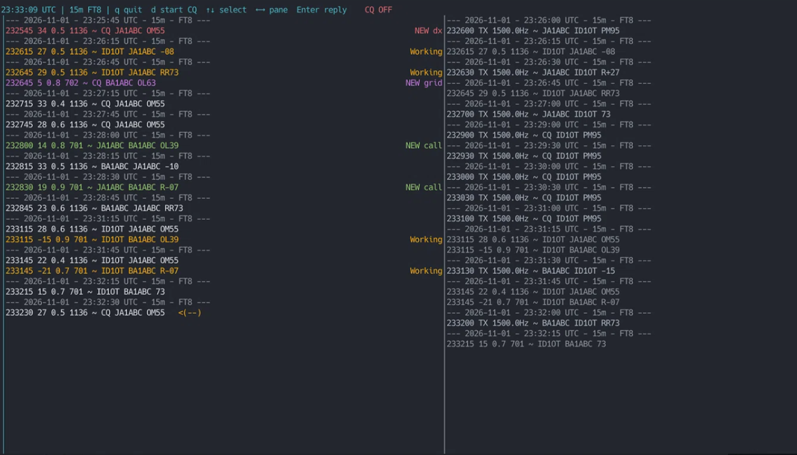

# XTWS-TUI

[English](README.md) | [中文](README.zh.md)

XTWS-TUI is a Rust-based FT8/FT4 weak-signal digital mode terminal tools. It enables multi-platform FT8 / FT4 automation connectivity.

## Features

- FT8 / FT4 audio capture and decoding
- Terminal UI showing RX / TX / event information
- Automatic tracking of worked callsigns, grids, and DXCC prefixes
- QSO state machine with automatic CQ and manual replies
- Runtime logs and ADIF QSO log output
- Configurable UI colors, sample rate, log directories, and frequency settings



## Requirements

On Linux, the project typically expects:

- Rust 2024 edition
- ALSA or PipeWire audio libraries
- A valid audio input/output device such as a sound card or USB audio interface
- A terminal environment that supports interactive TUI rendering

On Debian / Ubuntu, install the build dependencies with:

```bash
sudo apt install build-essential pkg-config libasound2-dev
```

## Quick Start

### 1. Install Rust

```bash
rustup default stable
```

### 2. Enter the project directory

```bash
cd xtws-tui
```

### 3. Build the project

```bash
cargo build --release
```

### 4. Run the application

```bash
cargo run --release
```

If you already have a built binary, you can also run it directly:

```bash
./target/release/xtws-tui
```

> If you are using a release build, the compiled binary can usually be launched directly without extra setup.

## Configuration

The main configuration file is [config/config.toml](config/config.toml).

### Minimal configuration

The smallest useful configuration is usually:

```toml
[user]
call = "JA1ABC"
grid = "PM95"
freq_mhz = 21.074

[device.radio]
protocol = "ft8"

[log.run]
dir = "logs/run"
keep_days = 30
mem_lines = 1000

[log.qso]
dir = "logs/qso"
keep_days = 3650

[log.worked]
calls_path = "logs/worked_calls.txt"
grids_path = "logs/worked_grids.txt"
```

This covers the essential station identity, protocol selection, and log locations. The application will fill in many defaults for audio, UI, and FT8/FT4 build settings if you do not override them.

Common configuration sections:

- `[user]`: callsign, grid, and operating frequency
- `[device.radio]`: protocol and radio mode settings
- `[ui]`: UI layout, refresh interval, colors, and filtering
- `[qso]`: auto-reply behavior, retry counts, and CQ settings
- `[log.run]` / `[log.qso]` / `[log.worked]`: log paths and retention settings
- `[build.ft8]` / `[build.ft4]`: transmit parameters and sample rates
- `[decode.ft8]` / `[decode.ft4]`: decode range settings

Example:

```toml
[user]
call = "JA1ABC"
grid = "PM95"
freq_mhz = 21.074

[device.radio]
protocol = "ft8"
```

## Project Structure

```text
.
├── Cargo.toml
├── README.md
├── README.zh.md
├── LICENSE
├── THIRD_PARTY_NOTICES.md
├── config/
│   └── config.toml
├── shell.nix
├── logs/
├── src/
│   ├── main.rs
│   ├── domain/
│   │   ├── mod.rs
│   │   ├── config.rs
│   │   ├── qso.rs
│   │   └── worked.rs
│   ├── infrastructure/
│   │   ├── mod.rs
│   │   ├── audio.rs
│   │   ├── decode.rs
│   │   ├── qso_log.rs
│   │   ├── run_log.rs
│   │   ├── signal.rs
│   │   └── slot.rs
│   └── presentation/
│       ├── mod.rs
│       └── ui/
│           ├── mod.rs
│           ├── feed.rs
│           └── tui.rs
├── target/
└── logs/
```

## Module Overview

- [src/main.rs](src/main.rs): application entry point coordinating config, audio, logs, decoding, and the TUI
- [src/domain/config.rs](src/domain/config.rs): configuration structs, defaults, and validation
- [src/domain/qso.rs](src/domain/qso.rs): QSO state machine and message handling
- [src/domain/worked.rs](src/domain/worked.rs): tracked callsign and grid cache
- [src/infrastructure/audio.rs](src/infrastructure/audio.rs): audio device management, capture, and playback
- [src/infrastructure/decode.rs](src/infrastructure/decode.rs): FT8 / FT4 decoder wrapper
- [src/infrastructure/run_log.rs](src/infrastructure/run_log.rs): runtime log recording
- [src/infrastructure/qso_log.rs](src/infrastructure/qso_log.rs): ADIF QSO log export
- [src/infrastructure/signal.rs](src/infrastructure/signal.rs): FT8 waveform generation and modulation signal synthesis
- [src/infrastructure/slot.rs](src/infrastructure/slot.rs): slot timing and parity logic
- [src/presentation/ui/feed.rs](src/presentation/ui/feed.rs): UI text formatting and status tagging
- [src/presentation/ui/tui.rs](src/presentation/ui/tui.rs): terminal interface and interaction handling

## Log Output

The program writes logs to the following locations:

- `logs/run/`: runtime logs grouped by date
- `logs/qso/`: ADIF QSO logs
- `logs/worked_calls.txt`: tracked callsigns
- `logs/worked_grids.txt`: tracked grids

## UI Controls

Common TUI controls:

- `q`: quit the application
- `d`: start CQ
- `↑ / ↓`: move up or down in the panel
- `← / →`: switch focus between left and right panes
- `Enter`: initiate or respond to a selected item

## Troubleshooting

### 1. No audio input or output device

Ensure ALSA or PipeWire is working correctly and that your configured input/output device names match actual hardware.

### 2. Build failure

If you hit dependency or system-library issues, verify the required packages are installed:

```bash
sudo apt install build-essential pkg-config libasound2-dev
```

### 3. Decoder is not producing results

Check the following:

- the configured frequency matches the protocol being used
- the sample rate is correct
- the input audio is valid FT8 / FT4 content
- the audio device is connected and receiving signal properly

## License

This project is licensed under GPL-3.0-only. Use, modification, and distribution must comply with the terms of the GNU General Public License v3.0.

Additional references:

- https://www.gnu.org/licenses/gpl-3.0.html
- https://spdx.org/licenses/GPL-3.0-only.html
